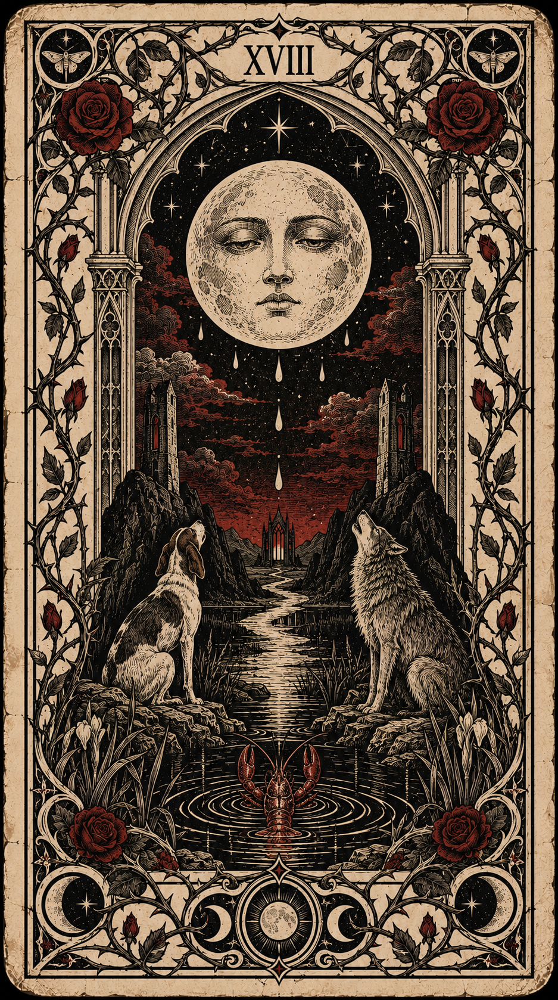
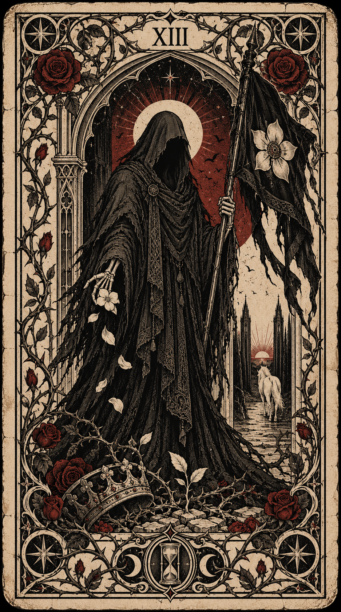

# Taro — Gothic Ivory Rose Tarot

สำรับกอทิกงาช้างและกุหลาบ · Digital Review Edition

สำรับ 78 ใบที่ออกแบบใหม่ในภาษาภาพพิมพ์กอทิก: หมึกดำ กระดาษงาช้างเก่า สีแดงหม่น กรอบกุหลาบและเถาหนาม อ้างอิงโครงสร้าง Rider–Waite–Smith (RWS) ใช้เพื่อสะสม อ่านไพ่ และเป็นชุดข้อมูลเริ่มต้นสำหรับพัฒนาเว็บไซต์

เปิด `START_HERE.html` หลังแตก ZIP เพื่ออ่านคู่มือในเบราว์เซอร์ แล้วเลือกเปิดแค็ตตาล็อกภาพทั้งหมดได้

## เปิดเว็บอ่านไพ่

`index.html` คือเว็บเลือกไพ่ และดูแค็ตตาล็อก เปิดไฟล์ตรง ๆ ไม่ได้ เพราะเบราว์เซอร์บล็อกการโหลด JSON และโมดูลจากไฟล์ในเครื่อง ให้เปิดผ่านเซิร์ฟเวอร์แบบ static จากโฟลเดอร์นี้:

```
python3 -m http.server 8000
```

แล้วเข้า `http://localhost:8000` (ถ้าพอร์ตนี้ถูกใช้อยู่ให้เปลี่ยนเลขพอร์ต) ฟอนต์โหลดจาก Google Fonts จึงต้องต่อเน็ตเพื่อให้ตัวอักษรตรงดีไซน์ ถ้าออฟไลน์จะใช้ฟอนต์สำรองของเครื่อง เว็บไม่เก็บและไม่ส่งคำถามหรือผลอ่านไปไหน

## เริ่มจากไฟล์ไหน

- `docs/01_READING_GUIDE_TH.md` วิธีเริ่มอ่านไพ่และอ่านไพ่กลับหัว
- `docs/02_CARD_MEANINGS_TH.md` ความหมายครบ 78 ใบและตัวอย่างประเด็นความรัก
- `docs/03_ART_DIRECTION_TH.md` แนวภาพ กรอบ สัญลักษณ์ และการเปลี่ยนจาก RWS
- `docs/04_WEB_HANDOFF_TH.md` โครงข้อมูลและข้อกำหนดสำหรับผู้พัฒนาเว็บ
- `docs/05_SOURCES_AND_PROVENANCE.md` แหล่งอ้างอิงและที่มาของเนื้อหา
- `docs/06_QA_AND_PRINT_TH.md` ผลตรวจและสิ่งที่ต้องตรวจเพิ่มก่อนพิมพ์
- `previews/catalog.html` เปิดดูไพ่ทั้งหมดในเครื่อง โดยไม่ต้องติดตั้งไลบรารี
- `data/cards.json` ข้อมูลไพ่ครบทุกใบ ภาษาไทยและชื่ออังกฤษ
- `data/spreads.json` รูปแบบการวางไพ่พร้อมตำแหน่ง
- `assets/cards/` ภาพ PNG ต้นฉบับที่ตั้งชื่อด้วยรหัสไพ่
- `assets/web/` สำเนา WebP สำหรับหน้าเว็บ
- `scripts/reading-core.mjs` ตัวอย่างแกนสุ่ม/จั่วและบันทึกผลสำหรับเว็บ
- `data/generation_jobs.json` คำสั่งสร้างภาพสำหรับพัฒนาต่อ

## ขอบเขตฉบับนี้

เป็น Digital Review Edition ยังไม่ใช่งานเตรียมพิมพ์ CMYK หรือไฟล์ที่มีระยะตัดตก มีเอกสารอธิบายภาพที่ดัดแปลงและผลตรวจจริง ไม่ควรอนุมานว่าทุกภาพทำตามต้นฉบับ RWS ทุกจุด

ความหมายเป็นการเรียบเรียงสมัยใหม่เพื่อสำรวจสถานการณ์และทางเลือก ไม่ใช่คำแปลตรงของ Waite และไม่ใช่หลักฐานยืนยันเหตุการณ์ในอนาคตหรือความคิดลับของบุคคลอื่น โทนมืดของภาพไม่ได้ทำให้ทุกใบมีความหมายด้านลบ

ชื่อสำรับเป็นชื่อทำงาน เปลี่ยนได้ก่อนเผยแพร่ ภาพอ้างอิงที่ผู้ใช้แนบไม่รวมในแพ็กนี้ และไม่มีการรับรองสิทธิผูกขาดของภาพที่สร้างด้วย AI

## สิทธิ์การใช้งาน

โค้ด (`index.html` และ `scripts/`) ใช้สัญญาอนุญาต MIT ตามไฟล์ `LICENSE` ส่วนภาพไพ่ซึ่งสร้างด้วย AI ทั้งหมด และข้อความความหมายใน `data/` กับ `docs/` ไม่รวมอยู่ในสัญญานี้ ไม่มีการอ้างหรือรับรองสิทธิผูกขาดในภาพ และไม่ได้อนุญาตให้นำภาพหรือข้อความไปใช้ซ้ำ

## ตรวจข้อมูลอีกครั้ง

จากโฟลเดอร์นี้ รัน `python3 scripts/package_deck.py --check-only` เพื่อตรวจจำนวน ID ไฟล์ภาพ ขนาด และ checksum หรือ `node scripts/reading-core.test.mjs` เพื่อตรวจตรรกะการสุ่มแบบไม่ซ้ำ

## ดาวน์โหลดจาก GitHub

เลือก **Code → Download ZIP** แล้วแตกไฟล์ เปิด `START_HERE.html` เพื่ออ่านคู่มือ หรือ `previews/catalog.html` เพื่อดูภาพครบ 78 ใบ

## ตัวอย่างภาพ

 

## ตรวจไฟล์และข้อมูล

ใช้ Python 3 พร้อม Pillow สำหรับ `python3 scripts/package_deck.py --check-only` และ Node.js สำหรับ `node scripts/reading-core.test.mjs` โค้ดอ่านไพ่ไม่ต้องเรียก API ภายนอก
