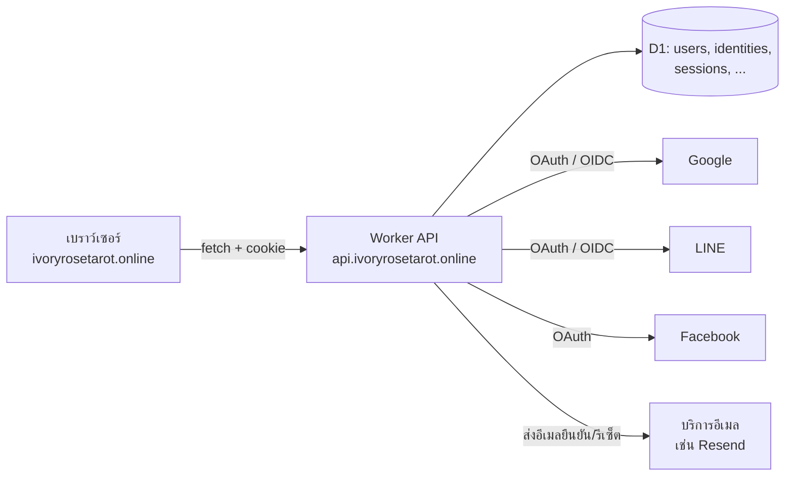
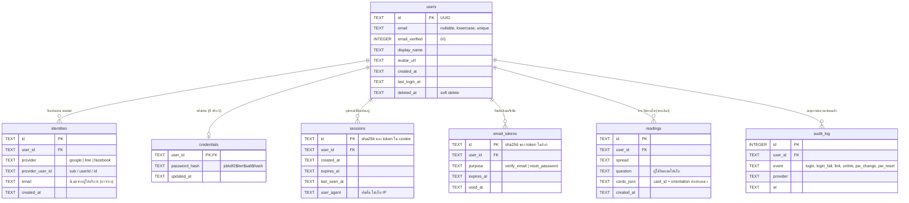
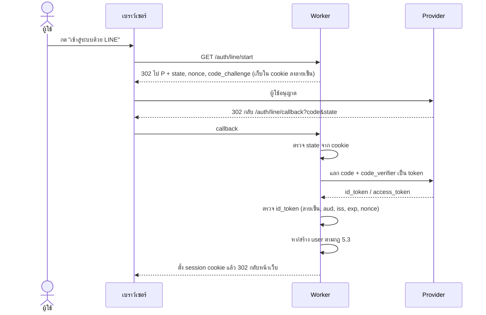
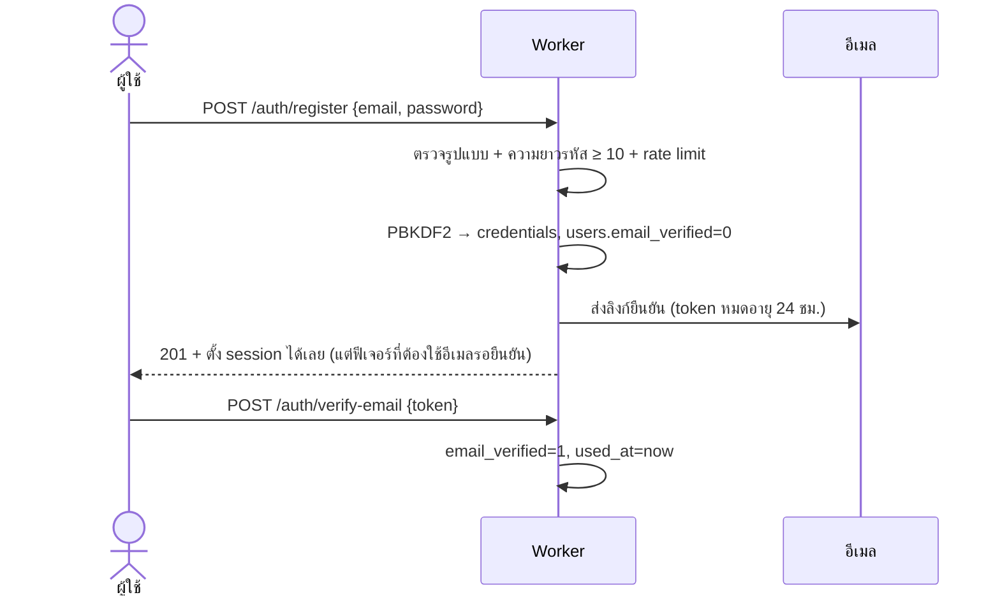
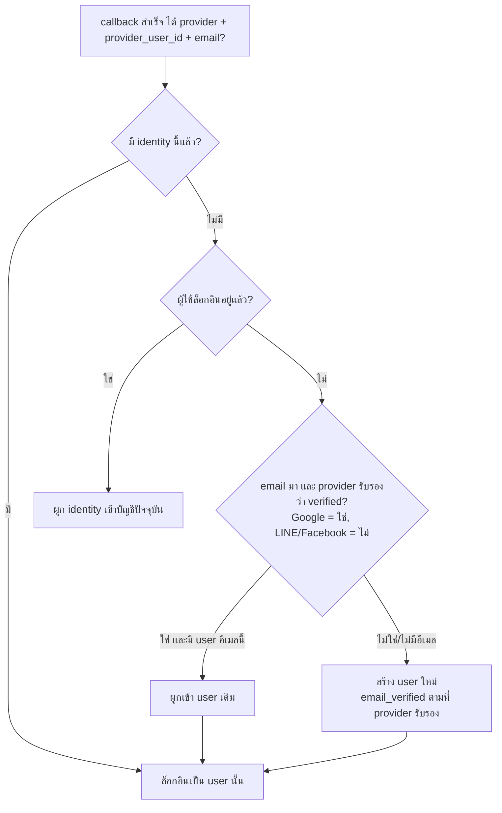

# แผน Backend: ระบบสมัคร/เข้าสู่ระบบ (Google, LINE, Facebook + อีเมลรหัสผ่าน)

สถานะ: แผน ยังไม่มีโค้ด เขียนบนฐานที่มีอยู่แล้ว คือ Cloudflare Workers + D1 (ดู `docs/DEPLOY_TH.md`)

## 1. เป้าหมายและขอบเขต

- เข้าสู่ระบบได้ 4 ทาง: Google, LINE, Facebook และสมัครด้วยอีเมล + รหัสผ่าน
- บัญชีเดียวผูกได้หลายวิธี เช่น สมัครด้วยอีเมลแล้วผูก LINE ภายหลัง
- เว็บยังใช้ได้โดยไม่ล็อกอิน การล็อกอินเป็นทางเลือก ไว้เก็บประวัติการอ่านไพ่และตั้งค่า
- นอกขอบเขตรอบแรก: Apple Sign-In, 2FA, ระบบชำระเงิน

## 2. สถาปัตยกรรม



ข้อตัดสินใจหลัก

| เรื่อง | เลือก | เหตุผล |
|---|---|---|
| โฮสต์ API | Worker ตัวใหม่ (`taro-api`) แยกจาก `taro-log` | ตัวเก็บคำถามเดิมเล็กและเปิดสาธารณะ ไม่ควรปนกับโค้ดที่แตะรหัสผ่าน |
| โดเมน | `api.` ซับโดเมนของเว็บเดียวกัน | cookie เป็น same-site ทำให้ใช้ `SameSite=Lax` ได้ และไม่ต้องพึ่ง third-party cookie |
| Session | cookie ทึบแสง (random 256 บิต) เก็บ hash ใน D1 | เพิกถอนได้ทันที ง่ายกว่า JWT ที่ต้องทำ blacklist |
| Cookie | `HttpOnly; Secure; SameSite=Lax; Path=/; Domain=.ivoryrosetarot.online` | กัน XSS อ่าน token และกัน CSRF ระดับพื้นฐาน |
| OAuth | Authorization Code + PKCE + `state` + `nonce` | มาตรฐานปัจจุบัน ไม่ใช้ implicit flow |
| แฮชรหัสผ่าน | PBKDF2-SHA256 ผ่าน WebCrypto (≥ 600,000 รอบ) + salt สุ่มรายคน | Argon2/bcrypt ไม่มีในรันไทม์ Workers แบบ native ถ้าต้องการ Argon2 ให้ใช้ WASM แล้วจ่ายค่า CPU เพิ่ม |
| อีเมล | ผู้ให้บริการภายนอก (Resend/Postmark ฯลฯ) | Worker ส่งอีเมลเองไม่ได้ ต้องใช้สำหรับยืนยันอีเมลและรีเซ็ตรหัสผ่าน |

## 3. ผังฐานข้อมูล

หลักคิด: ตาราง `users` เก็บตัวตน ส่วน "วิธีล็อกอิน" แยกไปตาราง `identities` (social) และ `credentials` (รหัสผ่าน) จึงผูกหลายวิธีเข้ากับบัญชีเดียวได้ และเพิ่มผู้ให้บริการใหม่ได้โดยไม่แก้โครงสร้าง



### SQL (D1 / SQLite)

```sql
CREATE TABLE users (
  id TEXT PRIMARY KEY,
  email TEXT UNIQUE COLLATE NOCASE,
  email_verified INTEGER NOT NULL DEFAULT 0,
  display_name TEXT,
  avatar_url TEXT,
  created_at TEXT NOT NULL,
  last_login_at TEXT,
  deleted_at TEXT
);
CREATE TABLE identities (
  id TEXT PRIMARY KEY,
  user_id TEXT NOT NULL REFERENCES users(id) ON DELETE CASCADE,
  provider TEXT NOT NULL CHECK (provider IN ('google','line','facebook')),
  provider_user_id TEXT NOT NULL,
  email TEXT,
  created_at TEXT NOT NULL,
  UNIQUE (provider, provider_user_id)
);
CREATE INDEX identities_user ON identities(user_id);
CREATE TABLE credentials (
  user_id TEXT PRIMARY KEY REFERENCES users(id) ON DELETE CASCADE,
  password_hash TEXT NOT NULL,
  updated_at TEXT NOT NULL
);
CREATE TABLE sessions (
  id TEXT PRIMARY KEY,
  user_id TEXT NOT NULL REFERENCES users(id) ON DELETE CASCADE,
  created_at TEXT NOT NULL,
  expires_at TEXT NOT NULL,
  last_seen_at TEXT NOT NULL,
  user_agent TEXT
);
CREATE INDEX sessions_user ON sessions(user_id);
CREATE INDEX sessions_exp ON sessions(expires_at);
CREATE TABLE email_tokens (
  id TEXT PRIMARY KEY,
  user_id TEXT NOT NULL REFERENCES users(id) ON DELETE CASCADE,
  purpose TEXT NOT NULL CHECK (purpose IN ('verify_email','reset_password')),
  expires_at TEXT NOT NULL,
  used_at TEXT
);
CREATE TABLE readings (
  id TEXT PRIMARY KEY,
  user_id TEXT NOT NULL REFERENCES users(id) ON DELETE CASCADE,
  spread TEXT NOT NULL,
  question TEXT,
  cards_json TEXT NOT NULL,
  created_at TEXT NOT NULL
);
CREATE INDEX readings_user ON readings(user_id, created_at DESC);
CREATE TABLE audit_log (
  id INTEGER PRIMARY KEY,
  user_id TEXT REFERENCES users(id) ON DELETE SET NULL,
  event TEXT NOT NULL,
  provider TEXT,
  at TEXT NOT NULL
);
```

ข้อควรจำ
- `state` / `nonce` / `code_verifier` ของ OAuth ที่ใช้ระหว่างพาไปหน้า provider เก็บใน cookie อายุ 10 นาที (ลงลายเซ็น HMAC) ไม่ต้องมีตาราง
- เก็บเฉพาะ hash ของ session token และ email token ถ้าฐานข้อมูลรั่ว token จริงก็ยังใช้ไม่ได้
- ไม่เก็บ IP ตามนโยบายเดิมของเว็บ ใช้ IP เป็นคีย์ rate limit เท่านั้น
- `users.email` ว่างได้ เพราะ LINE และ Facebook มักไม่ให้อีเมล (ต้องขอ scope และผู้ใช้ต้องมีอีเมลในบัญชี)

## 4. Endpoint

| Method | Path | หน้าที่ |
|---|---|---|
| POST | `/auth/register` | สมัครด้วยอีเมล + รหัสผ่าน แล้วส่งอีเมลยืนยัน |
| POST | `/auth/login` | อีเมล + รหัสผ่าน ตั้ง session cookie |
| POST | `/auth/logout` | ลบ session ปัจจุบัน |
| GET | `/auth/:provider/start` | สร้าง state/PKCE แล้ว redirect ไปหน้า provider (`google`, `line`, `facebook`) |
| GET | `/auth/:provider/callback` | แลก code เป็น token ตรวจ แล้วสร้าง/ผูกบัญชีและตั้ง session |
| POST | `/auth/verify-email` | ยืนยันอีเมลด้วย token |
| POST | `/auth/forgot-password` | ขอรีเซ็ต ตอบเหมือนกันเสมอไม่ว่ามีอีเมลนี้หรือไม่ |
| POST | `/auth/reset-password` | ตั้งรหัสใหม่ด้วย token แล้วลบ session ทั้งหมดของบัญชี |
| GET | `/me` | ข้อมูลผู้ใช้ + วิธีล็อกอินที่ผูกอยู่ |
| POST | `/me/identities/:provider` | ผูก social เพิ่ม (ต้องล็อกอินอยู่) |
| DELETE | `/me/identities/:provider` | เลิกผูก (ห้ามถ้าเหลือวิธีล็อกอินเดียวไม่ได้) |
| POST | `/me/password` | ตั้ง/เปลี่ยนรหัสผ่าน (คนที่เข้าผ่าน social อยากเพิ่มรหัสผ่านได้) |
| GET/POST/DELETE | `/me/readings` | ประวัติอ่านไพ่ ใช้ได้เมื่อล็อกอิน |
| DELETE | `/me` | ลบบัญชีและข้อมูลทั้งหมด (PDPA) |

## 5. ลำดับการทำงาน

### 5.1 Social login (Google / LINE / Facebook)



รายละเอียดแต่ละเจ้า

| Provider | โปรโตคอล | Scope | หมายเหตุ |
|---|---|---|---|
| Google | OIDC | `openid email profile` | `email_verified` มากับ id_token ใช้ `sub` เป็น id หลัก ไม่ใช้อีเมล |
| LINE | OAuth 2.1 / OIDC (LINE Login v2.1) | `profile openid email` | อีเมลต้องยื่นขอสิทธิ์ใน LINE Developers Console และผู้ใช้อาจไม่อนุญาต ต้องรองรับกรณีไม่มีอีเมล ฮิตมากในไทย ควรเป็นปุ่มแรก ๆ |
| Facebook | OAuth 2.0 (Graph API) | `public_profile email` | ต้องผ่านการตั้งค่า App (Privacy Policy URL, ลบข้อมูลผู้ใช้ callback) ถึงจะเปิดสาธารณะ อีเมลอาจว่าง และ Facebook ไม่รับรองว่าอีเมลยืนยันแล้ว จึงถือว่า **ยังไม่ verified** |

### 5.2 สมัคร/ล็อกอินด้วยอีเมล



- ถ้าอีเมลซ้ำ ตอบ 201 เหมือนสมัครสำเร็จและส่งอีเมล "มีบัญชีนี้อยู่แล้ว" ไปที่อีเมลนั้น เพื่อไม่ให้ใครเดาได้ว่าอีเมลไหนมีบัญชี
- ล็อกอินผิด ตอบข้อความเดียวกันทุกกรณี และเทียบเวลาให้เท่ากัน (ทำ hash ปลอมเมื่อไม่พบ user)

### 5.3 กฎผูกบัญชีเมื่อ social callback กลับมา



เหตุผลที่ไม่ผูกอัตโนมัติด้วยอีเมลที่ provider ไม่รับรอง: ถ้าผูก ผู้โจมตีสร้างบัญชี Facebook ด้วยอีเมลของเหยื่อแล้วยึดบัญชีเหยื่อได้ (account takeover) กรณี LINE/Facebook ที่ตรงกับอีเมลเดิม ให้ขึ้นหน้า "พบบัญชีที่ใช้อีเมลนี้ กรุณาล็อกอินด้วยวิธีเดิมแล้วผูกจากหน้าตั้งค่า"

## 6. ความปลอดภัย

- Rate limit: login 5 ครั้ง/นาที/IP และ 10 ครั้ง/ชั่วโมง/อีเมล, register และ forgot-password เข้มกว่า (ใช้ Rate Limiting binding เหมือน `taro-log`)
- CSRF: endpoint ที่เปลี่ยนข้อมูลรับเฉพาะ POST/DELETE ที่มี header `Origin` ตรงโดเมนเว็บ + cookie `SameSite=Lax` และ JSON `Content-Type`
- CORS: อนุญาตเฉพาะ `https://ivoryrosetarot.online` พร้อม `Access-Control-Allow-Credentials: true` (ห้ามใช้ `*`)
- Session: อายุ 30 วัน ต่ออายุเมื่อใช้งาน (sliding) เปลี่ยน session id หลังล็อกอิน/เปลี่ยนรหัส ลบ session ทั้งหมดเมื่อรีเซ็ตรหัส
- Token ในลิงก์อีเมล: สุ่ม 256 บิต ใช้ครั้งเดียว หมดอายุ (verify 24 ชม., reset 30 นาที)
- Redirect หลังล็อกอิน: รับเฉพาะ path ภายในเว็บ (กัน open redirect)
- Secret (client secret, คีย์ลงลายเซ็น cookie, คีย์อีเมล): เก็บด้วย `wrangler secret put` ห้ามอยู่ใน repo
- ตรวจ `id_token` ให้ครบ: ลายเซ็นจาก JWKS ของ provider, `iss`, `aud`, `exp`, `nonce`
- Log: ไม่บันทึกรหัสผ่าน token หรืออีเมลลง log

## 7. ผลต่อนโยบายความเป็นส่วนตัว (ต้องตัดสินใจก่อนทำ)

ตอนนี้เว็บบอกผู้ใช้ว่า "ผลอ่านอยู่ในเครื่องของคุณเท่านั้น" และ "ไม่เก็บชื่อ อีเมล" พอมีบัญชีผู้ใช้ ข้อความนี้ใช้ไม่ได้อีกต่อไปสำหรับคนที่ล็อกอิน ต้อง

- เขียนหน้านโยบายความเป็นส่วนตัว (PDPA): เก็บอะไร เพื่ออะไร นานเท่าไร ลบอย่างไร
- Facebook บังคับให้มี Privacy Policy URL และช่องทางลบข้อมูลก่อนเปิดใช้สาธารณะ
- ให้ผู้ใช้เลือกเองว่าจะบันทึกประวัติหรือไม่ (opt-in) โดยค่าเริ่มต้นไม่บันทึก
- ผู้ใช้ที่ไม่ล็อกอินยังได้ประสบการณ์เดิม ไม่เปลี่ยน

## 8. แผนทำเป็นเฟส

| เฟส | งาน | ผลที่ได้ |
|---|---|---|
| 0 | ตัดสินใจข้อในหัวข้อ 9, จดโดเมน `api.`, สมัครบริการอีเมล, ลงทะเบียน app ที่ Google/LINE/Facebook | ได้ client id/secret |
| 1 | Worker `taro-api` + schema + helper (session, cookie, hash, rate limit) + เทสต์หน่วย | โครงพร้อม ยังไม่มี UI |
| 2 | สมัคร/ล็อกอินอีเมล, ยืนยันอีเมล, ลืมรหัสผ่าน | login แบบปกติใช้งานได้ |
| 3 | Google (ง่ายสุด ใช้ทดสอบ flow OIDC), แล้ว LINE, แล้ว Facebook | social ครบ |
| 4 | หน้าตั้งค่าบัญชี: ผูก/เลิกผูก, เปลี่ยนรหัส, ลบบัญชี | จัดการบัญชีได้ |
| 5 | UI ในเว็บ (ปุ่มล็อกอิน, เมนูบัญชี), บันทึก/ดูประวัติการอ่าน, หน้านโยบาย | ใช้งานจริง |
| 6 | เทสต์ e2e (Playwright + provider จำลอง), ตรวจความปลอดภัย, ตั้งงานลบ session หมดอายุ | พร้อมเปิดจริง |

การทดสอบ: ทำ provider จำลอง (mock OIDC server) ใน test เพื่อไม่ต้องยิง Google/LINE/Facebook จริง และเขียนเทสต์ที่ครอบคลุมกฎผูกบัญชีข้อ 5.3 ทุกกิ่ง เพราะเป็นจุดเสี่ยงที่สุด

## 9. คำถามที่ต้องตอบก่อนเริ่มเขียนโค้ด

1. จะเก็บประวัติการอ่านไพ่ของผู้ใช้หรือไม่ (ถ้าไม่ ตาราง `readings` ตัดได้ และเรื่องความเป็นส่วนตัวง่ายขึ้นมาก)
2. ใช้ผู้ให้บริการอีเมลเจ้าไหน และมีโดเมนสำหรับตั้ง SPF/DKIM แล้วหรือยัง
3. ต้องมี Apple Sign-In ไหม (จำเป็นถ้าทำแอปบน iOS ที่มี social login อื่น เว็บอย่างเดียวไม่บังคับ)
4. ผู้ใช้ social ที่ไม่มีอีเมล (LINE/Facebook บางคน) ให้ใช้งานได้เลย หรือบังคับกรอกอีเมลก่อน
5. ใครเป็นเจ้าของ app ที่ Google/LINE/Facebook (ควรเป็นบัญชีองค์กร/เจ้าของโปรเจกต์ ไม่ใช่บัญชีส่วนตัวของคนใดคนหนึ่ง)
