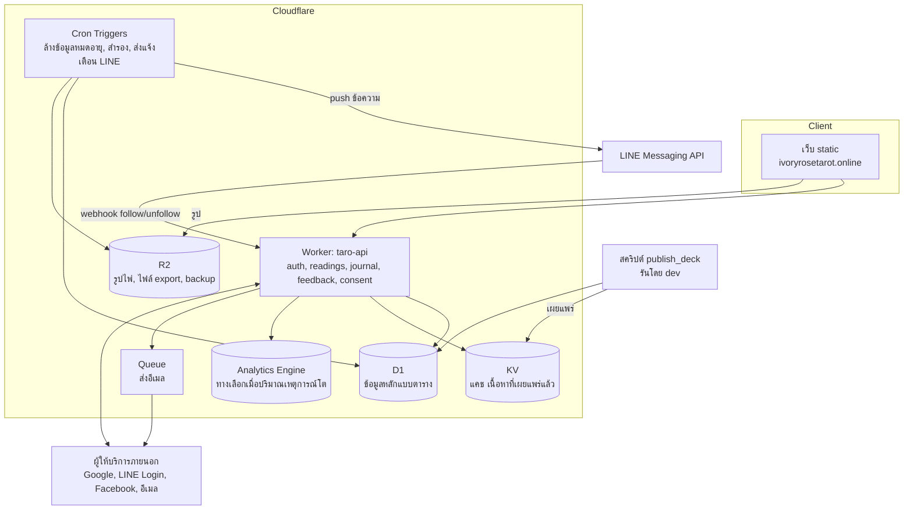
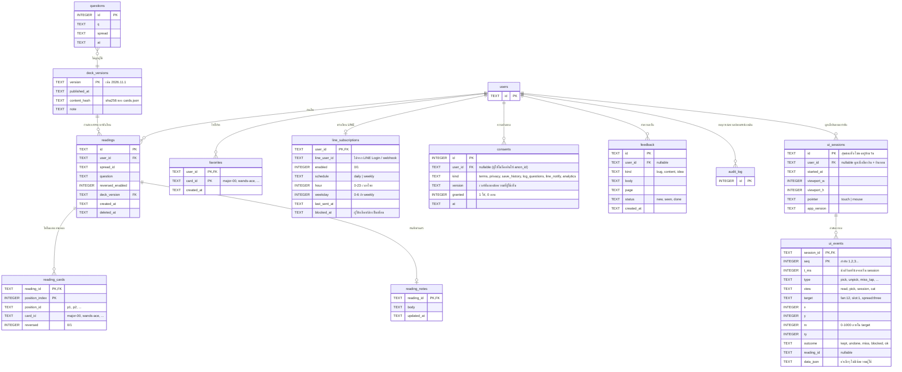
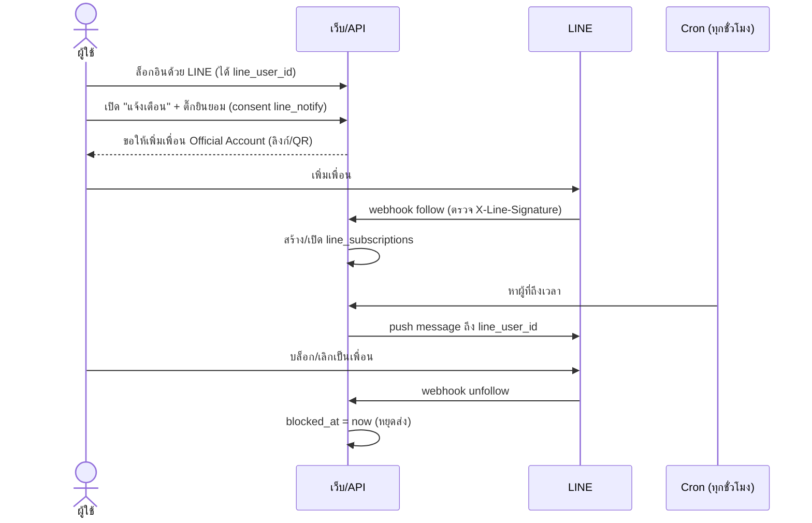

# แผน Backend ทั้งระบบ และการเก็บข้อมูลทุกประเภท

สถานะ: แผน ยังไม่มีโค้ด ไฟล์นี้คือภาพรวมทั้งหมด ส่วนระบบล็อกอินลงรายละเอียดไว้ใน `docs/07_AUTH_BACKEND_PLAN_TH.md` (ตาราง `users`, `identities`, `credentials`, `sessions`, `email_tokens`, `audit_log` อยู่ในไฟล์นั้น ไม่ซ้ำที่นี่)

## สถานะการทำงานจริง (ทำเสร็จแล้ว)

โค้ดอยู่ใน `api/` (Worker `taro-api`), `worker/` (ตัวเก็บคำถามและลำดับการกด), หน้าเว็บ `account.html` และส่วนเพิ่มใน `index.html` คู่มือ deploy: `docs/DEPLOY_API_TH.md` และ `docs/DEPLOY_TH.md`

| เรื่อง | สถานะ | ที่ต่างจากแผนด้านล่าง |
|---|---|---|
| สมัคร/ล็อกอินอีเมล, ยืนยันอีเมล, ลืม/เปลี่ยนรหัสผ่าน | ทำแล้ว | ส่งอีเมลโดยตรงผ่าน Resend ไม่ผ่าน Queue |
| Google / LINE / Facebook | ทำแล้ว (ทดสอบกับ provider จำลอง) | อีเมลที่ provider ไม่รับรองไม่ถูกเก็บใน `users.email` |
| ผูก/เลิกผูก, เพิ่ม/เปลี่ยนอีเมล, ลบบัญชี, ส่งออกข้อมูล | ทำแล้ว | ส่งออกเป็น JSON ดาวน์โหลดตรง (`GET /me/export`) ไม่ผ่าน R2 |
| ความยินยอม | ทำแล้ว | `consents` ผูกกับผู้ใช้และลบพร้อมบัญชี (ไม่เก็บหลักฐานแบบไม่ระบุตัวตนหลังลบ) |
| ประวัติการอ่าน + โน้ต, ไพ่โปรด | ทำแล้ว | ลบรายการเป็นการลบจริง ไม่มี `deleted_at`; `deck_version` เป็น hash ของสำรับที่ API บันเดิลไว้ ไม่ใช่เวอร์ชันที่ไคลเอนต์ส่งมา |
| ไพ่รายวัน | ทำแล้ว | ตามแผน |
| แจ้งเตือน LINE, feedback | ทำแล้ว (ทดสอบกับ LINE จำลอง) | `line_subscriptions` มีคอลัมน์ `friend` เพิ่ม |
| บันทึกลำดับการกด | ทำแล้ว | ตามแผน |
| `deck_versions` + สคริปต์ publish, KV, Analytics Engine, Admin UI | **ไม่ได้ทำ** | ไม่จำเป็นในรอบนี้ (เนื้อหาเปลี่ยนผ่าน Git และ deploy ใหม่) |

## 0. ข้อตัดสินใจที่ล็อกแล้ว

| เรื่อง | ตัดสินใจ | ผลต่อแผน |
|---|---|---|
| ฟีเจอร์รอบแรก | ประวัติการอ่าน + บันทึกส่วนตัว + **ไพ่โปรด + ไพ่รายวัน** | เพิ่มตาราง `favorites` และ endpoint ไพ่รายวัน (หัวข้อ 4.1) |
| คนแก้เนื้อหา | มีแต่ dev | **ตัดทิ้ง:** Admin UI และ `admin_roles` ใช้ Git + สคริปต์ publish |
| เข้ารหัสคำถาม/บันทึกระดับแอป | ไม่ทำ | เก็บเป็นข้อความธรรมดาใน D1 ป้องกันด้วยสิทธิ์เข้าถึงและการไม่ใส่ใน log |
| กลุ่มผู้ใช้ | ไทยก่อน | ยึด PDPA เป็นหลัก ไม่ทำ GDPR รอบแรก (อธิบายด้านล่าง) |
| แจ้งเตือน | LINE อย่างเดียว | เพิ่มหัวข้อ 5.1 และตาราง `line_subscriptions` ไม่ทำอีเมลแจ้งเตือน |

**GDPR คืออะไร:** General Data Protection Regulation เป็นกฎหมายคุ้มครองข้อมูลส่วนบุคคลของสหภาพยุโรป ใช้กับเว็บที่ "เสนอบริการให้คนในยุโรป" หรือ "ติดตามพฤติกรรมของคนในยุโรป" แม้ผู้ให้บริการจะอยู่นอกยุโรป ถ้าเป้าหมายคือคนไทยและไม่ได้โปรโมตหรือรองรับคนยุโรปโดยเฉพาะ ก็ยังไม่เข้าข่ายชัดเจน ส่วนกฎหมายที่ใช้กับเว็บนี้คือ **PDPA ของไทย** ซึ่งมีหลักคล้ายกัน (แจ้งวัตถุประสงค์, ขอความยินยอม, ให้ผู้ใช้เข้าถึง/ลบข้อมูลได้, แจ้งเหตุข้อมูลรั่วต่อสำนักงาน คปส. ภายใน 72 ชั่วโมง) แผนนี้ออกแบบรองรับข้อเหล่านี้ไว้แล้ว (consents, export, ลบบัญชี) จึงขยายไป GDPR ภายหลังได้ไม่ยาก ควรให้ผู้เชี่ยวชาญกฎหมายตรวจนโยบายความเป็นส่วนตัวก่อนเปิดจริง โดยเฉพาะเรื่องข้อมูลที่ประมวลผลบนเซิร์ฟเวอร์นอกประเทศ

## 1. ภาพรวม

ตอนนี้เว็บเป็น static ทั้งหมด (HTML + JSON + รูป) มี backend อย่างเดียวคือ Worker เก็บคำถาม แผนนี้เพิ่ม backend จริง แต่ยังอยู่บน Cloudflare เพื่อไม่ต้องดูแลเซิร์ฟเวอร์เอง



## 2. ข้อมูลทุกอย่างเก็บที่ไหน

| ข้อมูล | ที่เก็บ | เหตุผล | เก็บนานแค่ไหน |
|---|---|---|---|
| บัญชีผู้ใช้, วิธีล็อกอิน, session | D1 | ต้อง query และ join ต้องถูกต้องเสมอ | จนผู้ใช้ลบบัญชี, session หมดอายุ 30 วัน |
| รหัสผ่าน | D1 (เฉพาะ hash) | ไม่เก็บรหัสจริง | จนลบบัญชี |
| ประวัติการอ่านไพ่ | D1 | ผู้ใช้ดูย้อนหลัง ลบรายการได้ | จนผู้ใช้ลบ (opt-in เท่านั้น) |
| บันทึกส่วนตัว (journal) ต่อการอ่าน | D1 | เป็นข้อความของผู้ใช้ | จนผู้ใช้ลบ |
| ความยินยอม (consent) | D1 | ต้องพิสูจน์ได้ว่าใครยินยอมอะไร เมื่อไหร่ | ตามกฎหมาย แม้บัญชีถูกลบให้เก็บแบบไม่ระบุตัวตน |
| คำถามแบบไม่ล็อกอิน (ตัวเก็บเดิม) | D1 ตาราง `questions` | มีอยู่แล้ว ไม่ผูกกับผู้ใช้ | 90 วัน แล้วลบอัตโนมัติ |
| Feedback / รายงานปัญหา | D1 | admin ต้องจัดการสถานะ | 1 ปี |
| ลำดับการกด/คลิกของผู้ใช้ (ตำแหน่ง, ก่อน-หลัง, ถูก/พลาด) | D1 ตาราง `ui_sessions` + `ui_events` | ต้อง query ลำดับและรวมสถิติ (หัวข้อ 4.2) | ดิบ 30 วัน แล้วรวมเป็นสถิติรายวัน (`ui_daily_stats`) เก็บถาวร |
| เนื้อหาไพ่/spread/ความหมาย (ต้นฉบับ) | Git (`data/*.json`) | ตรวจทานได้ มีประวัติ เป็นแหล่งจริง | ถาวร |
| เนื้อหาที่เผยแพร่แล้ว (สำเนาให้เว็บอ่านเร็ว) | KV + JSON ใน static | อ่านบ่อย เขียนน้อย | แทนที่เมื่อเผยแพร่ใหม่ |
| รูปไพ่ PNG ต้นฉบับ + WebP | R2 (เว็บยังใช้ไฟล์ใน repo ได้ระหว่างเปลี่ยนผ่าน) | ไฟล์ใหญ่ ไม่ควรอยู่ใน D1 | ถาวร |
| การสมัครแจ้งเตือน LINE (LINE user id, ความถี่) | D1 | ต้องรู้ว่าส่งให้ใคร เมื่อไหร่ | จนผู้ใช้ปิดแจ้งเตือนหรือลบบัญชี |
| ไพ่โปรด | D1 ตาราง `favorites` | ข้อมูลเล็กผูกกับผู้ใช้ | จนผู้ใช้ลบหรือลบบัญชี |
| ไพ่รายวัน | คำนวณสด ไม่เก็บ (แคชใน KV ได้) | ใบเดียวกันทั้งเว็บ คำนวณจากวันที่ + คีย์ลับ ไม่ต้องมีตาราง | - |
| ไฟล์ export ข้อมูลผู้ใช้ (PDPA) | R2 ชั่วคราว | ให้ดาวน์โหลดครั้งเดียว | 24 ชั่วโมง |
| Backup ฐานข้อมูล | R2 | กู้คืนเมื่อเสียหาย | 30 วันย้อนหลัง |
| Secret (client secret, คีย์ลงลายเซ็น) | Worker secrets | ห้ามอยู่ใน repo หรือ DB | หมุนคีย์ปีละครั้ง |

ข้อสำคัญ: ต้นฉบับเนื้อหาไพ่ **ยังเก็บใน Git** ไม่ย้ายเข้า DB ตอนนี้ เพราะผ่านการตรวจด้วยสคริปต์ (`scripts/validate_data.py`) และมีประวัติแก้ไข ย้ายไป DB เมื่อมีคนที่ไม่ใช่ dev ต้องแก้เนื้อหาบ่อย (ดูหัวข้อ 6)

## 3. ผังตารางข้อมูลทั้งหมด

ตารางส่วนล็อกอินเป็นสีเทา (รายละเอียดใน 07) ที่เหลือคือตารางใหม่



### SQL (ตารางใหม่)

```sql
CREATE TABLE deck_versions (
  version TEXT PRIMARY KEY,
  published_at TEXT NOT NULL,
  content_hash TEXT NOT NULL,
  note TEXT
);

CREATE TABLE readings (
  id TEXT PRIMARY KEY,
  user_id TEXT NOT NULL REFERENCES users(id) ON DELETE CASCADE,
  spread_id TEXT NOT NULL,
  question TEXT,
  reversed_enabled INTEGER NOT NULL DEFAULT 0,
  deck_version TEXT NOT NULL REFERENCES deck_versions(version),
  created_at TEXT NOT NULL,
  deleted_at TEXT
);
CREATE INDEX readings_user ON readings(user_id, created_at DESC);

CREATE TABLE reading_cards (
  reading_id TEXT NOT NULL REFERENCES readings(id) ON DELETE CASCADE,
  position_index INTEGER NOT NULL,
  position_id TEXT NOT NULL,
  card_id TEXT NOT NULL,
  reversed INTEGER NOT NULL DEFAULT 0,
  PRIMARY KEY (reading_id, position_index),
  UNIQUE (reading_id, card_id)            -- ไพ่ไม่ซ้ำในการอ่านเดียว
);
CREATE INDEX reading_cards_card ON reading_cards(card_id);   -- สถิติไพ่ที่ถูกเปิดบ่อย

CREATE TABLE reading_notes (
  reading_id TEXT PRIMARY KEY REFERENCES readings(id) ON DELETE CASCADE,
  body TEXT NOT NULL,
  updated_at TEXT NOT NULL
);

CREATE TABLE consents (
  id INTEGER PRIMARY KEY,
  user_id TEXT REFERENCES users(id) ON DELETE SET NULL,
  anon_id TEXT,                              -- สุ่มเก็บในเบราว์เซอร์ สำหรับคนไม่ล็อกอิน
  kind TEXT NOT NULL CHECK (kind IN ('terms','privacy','save_history','log_questions','line_notify','analytics')),
  version TEXT NOT NULL,
  granted INTEGER NOT NULL,
  at TEXT NOT NULL
);
CREATE INDEX consents_user ON consents(user_id, kind, at DESC);

CREATE TABLE ui_sessions (
  id TEXT PRIMARY KEY,
  user_id TEXT REFERENCES users(id) ON DELETE CASCADE,
  started_at TEXT NOT NULL,
  viewport_w INTEGER, viewport_h INTEGER,
  pointer TEXT CHECK (pointer IN ('touch','mouse')),
  app_version TEXT
);
CREATE INDEX ui_sessions_started ON ui_sessions(started_at);
CREATE INDEX ui_sessions_user ON ui_sessions(user_id);

CREATE TABLE ui_events (
  session_id TEXT NOT NULL REFERENCES ui_sessions(id) ON DELETE CASCADE,
  seq INTEGER NOT NULL,
  t_ms INTEGER NOT NULL,
  type TEXT NOT NULL,
  view TEXT,
  target TEXT,
  x INTEGER, y INTEGER,
  rx INTEGER, ry INTEGER,
  outcome TEXT CHECK (outcome IN ('ok','kept','undone','miss','blocked')),
  reading_id TEXT,
  data_json TEXT,
  PRIMARY KEY (session_id, seq)
) WITHOUT ROWID;
CREATE INDEX ui_events_type ON ui_events(type, outcome);

CREATE TABLE ui_daily_stats (        -- สถิติรวมรายวัน เก็บถาวร ไม่มีตัวตน
  day TEXT NOT NULL,
  type TEXT NOT NULL,
  view TEXT,
  outcome TEXT,
  pointer TEXT,
  n INTEGER NOT NULL,
  PRIMARY KEY (day, type, view, outcome, pointer)
);

CREATE TABLE feedback (
  id TEXT PRIMARY KEY,
  user_id TEXT REFERENCES users(id) ON DELETE SET NULL,
  kind TEXT NOT NULL CHECK (kind IN ('bug','content','idea')),
  body TEXT NOT NULL,
  page TEXT,
  status TEXT NOT NULL DEFAULT 'new' CHECK (status IN ('new','seen','done')),
  created_at TEXT NOT NULL
);

CREATE TABLE favorites (
  user_id TEXT NOT NULL REFERENCES users(id) ON DELETE CASCADE,
  card_id TEXT NOT NULL,
  created_at TEXT NOT NULL,
  PRIMARY KEY (user_id, card_id)
);

CREATE TABLE line_subscriptions (
  user_id TEXT PRIMARY KEY REFERENCES users(id) ON DELETE CASCADE,
  line_user_id TEXT NOT NULL UNIQUE,
  enabled INTEGER NOT NULL DEFAULT 1,
  schedule TEXT NOT NULL DEFAULT 'weekly' CHECK (schedule IN ('daily','weekly')),
  hour INTEGER NOT NULL DEFAULT 19 CHECK (hour BETWEEN 0 AND 23),
  weekday INTEGER CHECK (weekday BETWEEN 0 AND 6),
  last_sent_at TEXT,
  blocked_at TEXT
);
CREATE INDEX line_due ON line_subscriptions(enabled, schedule, hour) WHERE blocked_at IS NULL;
```

ทำไมแยก `reading_cards` ออกจาก `readings` แทนการเก็บ JSON ก้อนเดียว: query สถิติได้ (ไพ่ไหนถูกเปิดบ่อย, ตำแหน่งไหนมักได้ไพ่ลักษณะไหน) บังคับ "ไม่ซ้ำ" ที่ฐานข้อมูลได้ และไม่ต้องแก้ JSON ทุกครั้งที่เปลี่ยนโครง

ทำไมมี `deck_versions`: ถ้าวันหน้าแก้ความหมายไพ่หรือเปลี่ยนชื่อ ประวัติเก่าต้องแสดงตามเวอร์ชันที่ผู้ใช้เห็นตอนนั้นได้ และ `card_id` ต้องไม่เปลี่ยนความหมายย้อนหลัง

## 4. API ภาพรวม (นอกเหนือจาก auth ใน 07)

| Method | Path | หน้าที่ | ล็อกอิน |
|---|---|---|---|
| GET | `/content/deck` | เนื้อหาไพ่ที่เผยแพร่ล่าสุด + `deck_version` (แคชที่ KV) | ไม่ |
| POST | `/log/question` | ตัวเก็บคำถามเดิม (ย้ายมารวมได้ภายหลัง) | ไม่ |
| POST | `/events` | ส่งลำดับการกดเป็นชุด (batch) ดูหัวข้อ 4.2 | ไม่ (ต้องมี consent `analytics`) |
| POST | `/feedback` | ส่งความเห็น/แจ้งปัญหา | ไม่ (ล็อกอินแล้วผูกให้) |
| POST | `/consents` | บันทึกการให้/ถอนความยินยอม | ไม่ (ใช้ `anon_id`) |
| GET | `/me/readings?cursor=` | รายการประวัติ (แบ่งหน้า) | ใช่ |
| POST | `/me/readings` | บันทึกการอ่านหนึ่งครั้ง | ใช่ + ต้องมี consent `save_history` |
| GET | `/me/readings/:id` | ดูรายละเอียดหนึ่งรายการ | ใช่ (เจ้าของเท่านั้น) |
| PUT | `/me/readings/:id/note` | เขียน/แก้บันทึก | ใช่ |
| DELETE | `/me/readings/:id` | ลบรายการ | ใช่ |
| GET | `/content/daily` | ไพ่รายวัน (ใบเดียวกันทุกคน) ดูหัวข้อ 4.1 | ไม่ |
| GET | `/me/favorites` | รายการไพ่โปรดทั้งหมด | ใช่ |
| PUT/DELETE | `/me/favorites/:card_id` | เพิ่ม/เอาออก (PUT ซ้ำได้ ผลเหมือนเดิม) ตรวจว่า `card_id` มีใน deck | ใช่ |
| GET/PUT/DELETE | `/me/line-notify` | ดู/ตั้ง/ปิดการแจ้งเตือน LINE (ความถี่, เวลา) | ใช่ + consent `line_notify` |
| POST | `/line/webhook` | รับเหตุการณ์ follow/unfollow/block จาก LINE (ตรวจ `X-Line-Signature`) | ไม่ (ยืนยันด้วยลายเซ็น) |
| POST | `/me/export` | ขอไฟล์ข้อมูลทั้งหมดของตัวเอง (JSON ใน R2 ลิงก์ 24 ชม.) | ใช่ |
| DELETE | `/me` | ลบบัญชี + ข้อมูลทั้งหมด (ดู 07) | ใช่ |

กฎตรวจที่ฝั่งเซิร์ฟเวอร์ตอน `POST /me/readings`: `spread_id` ต้องมีใน spreads, จำนวนไพ่ตรงกับ spread, `card_id` ทุกใบมีใน deck_version ที่ส่งมา, ไม่ซ้ำ, `question` ไม่เกิน 300 ตัวอักษร, `note` ไม่เกิน 2,000 ตัวอักษร, ผู้ใช้หนึ่งคนบันทึกได้ไม่เกินจำนวนที่กำหนดต่อวัน

### 4.1 ไพ่รายวัน

หลักการ: ทุกคนเห็นไพ่ใบเดียวกันในวันเดียวกัน ไม่ต้องมีตารางและไม่ต้องมี cron

- คำนวณ `index = HMAC-SHA256(DAILY_SECRET, "YYYY-MM-DD@Asia/Bangkok") mod 78` แล้วหยิบไพ่จาก deck_version ล่าสุด เรียงตาม `order` ใน `cards.json` ใช้ผลที่ได้เป็นตัวเลขแบบ rejection sampling เหมือน `scripts/reading-core.mjs` เพื่อไม่ให้เอนเอียง
- ใช้คีย์ลับ (`wrangler secret put DAILY_SECRET`) เพื่อไม่ให้ใครล่วงรู้ไพ่ของวันหน้าล่วงหน้าได้ ผลที่ได้ซ้ำได้เสมอสำหรับวันเดียวกัน ไม่ต้องเก็บ
- ตัดวันตามเวลาไทย (UTC+7) ไม่ใช่ UTC ไม่งั้นผู้ใช้ไทยเห็นไพ่เปลี่ยนตอน 7 โมงเช้า
- ไพ่รายวันไม่กลับหัว เพื่อให้ข้อความอ่านง่ายและเหมือนกันทุกคน
- ตอบกลับ: `card_id`, `date`, `deck_version` และตั้ง `Cache-Control` ให้หมดอายุตอนเที่ยงคืนเวลาไทย เว็บดึงชื่อ ภาพ และความหมายจากข้อมูลไพ่ที่โหลดอยู่แล้ว
- ผู้ใช้ที่ล็อกอินแล้วกด "บันทึกลงประวัติ" ได้ ใช้ endpoint `POST /me/readings` เดิมด้วย `spread_id = 'single'` (ต้องมี consent `save_history`) และเสนอปุ่ม "เพิ่มเป็นไพ่โปรด" ที่ใช้ `PUT /me/favorites/:card_id`
- ย้อนดูไพ่ของวันก่อน ๆ ไม่ต้องเก็บ เรียก `GET /content/daily?date=YYYY-MM-DD` ได้ แต่จำกัดเฉพาะวันที่ผ่านมาแล้วถึงวันนี้ (ห้ามขอวันอนาคต)

**ข้อตัดสินใจเรื่องการสุ่มไพ่:** ตอนนี้สุ่มที่เบราว์เซอร์ (rejection sampling ใน `scripts/reading-core.mjs` มีเทสต์แล้ว) ผู้ใช้เลือกไพ่เองทีละใบ จึงไม่มีเหตุให้ย้ายไปสุ่มที่เซิร์ฟเวอร์ เซิร์ฟเวอร์รับเฉพาะ "ผลที่ผู้ใช้เลือก" ไปเก็บ และตรวจความถูกต้องของโครงสร้างเท่านั้น ไม่ยืนยันว่าสุ่มจริง (ไม่จำเป็น เพราะไม่มีรางวัลหรือผลทางการเงิน)

### 4.2 บันทึกลำดับการกดของผู้ใช้ (ก่อน-หลัง, ตำแหน่ง, ถูก/พลาด)

**เป้าหมาย:** รู้ว่าผู้ใช้ทำอะไรตามลำดับ กดตรงไหน กดแล้วเป็นอย่างไร เพื่อแก้ UX (เช่น ไพ่ซ้อนกันบนมือถือทำให้กดพลาดไหม) ไม่ใช่เพื่อติดตามตัวบุคคล

**นิยาม "ถูก/ผิด":** ทาโรต์ไม่มีไพ่ที่ "ถูก" จึงนิยามตามพฤติกรรมของ UI (ถ้าคุณหมายถึงอย่างอื่น บอกได้ ปรับ `outcome` ได้)

| `outcome` | ความหมาย | ตรวจจับจากโค้ดเดิม |
|---|---|---|
| `kept` (ใช้จริง) | เลือกไพ่แล้วคงไว้จนเปิดคำอ่าน | ไพ่ที่ยังอยู่ใน `pk.picks` ตอน `finishPick` |
| `undone` (เลือกแล้วยกเลิก) | เลือกแล้วเอากลับ ถือว่าเปลี่ยนใจหรือกดผิดใบ | `unpick()` เรียกจากการแตะไพ่ซ้ำหรือแตะช่อง |
| `miss` (กดพลาด) | แตะในพื้นที่วงล้อแต่ไม่โดนไพ่ใบใด | `$('fan').onclick` ได้ `b == null` |
| `blocked` | แตะไพ่ตอนช่องเต็มแล้ว ไม่มีผล | `slot < 0` ใน `$('fan').onclick` |
| `ok` | การกดทั่วไปที่ไม่มีถูก/ผิด เช่น เปลี่ยนเมนู | ค่าเริ่มต้น |

**เหตุการณ์ที่บันทึก (`type`)** ตามปุ่ม/ขั้นตอนที่มีอยู่ใน `index.html`

| กลุ่ม | type |
|---|---|
| นำทาง | `view_enter` (read/cat), `home` |
| ตั้งค่า | `spread_select`, `reversed_toggle` |
| เลือกไพ่ | `start_pick`, `wheel_spin` (ลากวงล้อ), `pick`, `unpick`, `pick_kept` (สรุปไพ่ที่คงไว้ตอนเปิดคำอ่าน), `miss_tap`, `blocked_tap`, `pick_cancel`, `auto_open` |
| อ่านผล | `card_open`, `open_all`, `jump_to_reading` |
| แค็ตตาล็อก | `catalog_search` (เก็บแค่ความยาวคำค้นและจำนวนผลใน `data_json` ไม่เก็บข้อความ), `catalog_filter`, `dialog_open`, `dialog_close` |

**ตำแหน่งที่กด:** `x`,`y` เป็นพิกเซลใน viewport (ใช้ร่วมกับ `viewport_w/h` วาดแผนที่ความร้อน) และ `rx`,`ry` เป็นสัดส่วนภายในองค์ประกอบที่กด 0–1000 (เช่นกดชายซ้ายของไพ่ใบที่ 12 ในวงล้อ) `target` ระบุชนิดและดัชนี เช่น `fan:12`, `slot:1`, `spread:three` ซึ่งบอกได้ว่าไพ่ใบไหนในวงล้อถูกกด ส่วนไพ่จริงที่อยู่ในช่องนั้นหาได้จากผลที่บันทึกใน `reading_cards`

**ก่อน-หลัง:** `seq` เรียงต่อเนื่องในแต่ละ session และ `t_ms` เป็นเวลาที่ผ่านไป จึงรู้ทั้งลำดับและความหน่วง ไม่ต้องเก็บ "ก่อนหน้า/ถัดไป" แยก ใช้ window function ของ SQLite ได้

```sql
-- หลังกดพลาด ผู้ใช้ทำอะไรต่อ (และใช้เวลาเท่าไร)
SELECT next_type, COUNT(*) n, AVG(next_t - t_ms) avg_ms FROM (
  SELECT type, t_ms,
         LEAD(type) OVER w AS next_type, LEAD(t_ms) OVER w AS next_t
  FROM ui_events WINDOW w AS (PARTITION BY session_id ORDER BY seq)
) WHERE type = 'miss_tap' GROUP BY next_type ORDER BY n DESC;

-- สัดส่วนยกเลิกการเลือก แยกตามมือถือ/เมาส์
SELECT s.pointer, SUM(e.outcome='undone') * 1.0 / SUM(e.type='pick') AS undo_rate
FROM ui_events e JOIN ui_sessions s ON s.id = e.session_id
WHERE e.type IN ('pick','unpick') GROUP BY s.pointer;

-- กดพลาดเกิดแถวไหนของวงล้อ (ตรวจปัญหาพื้นที่กดซ้อนกัน)
SELECT rx/100 AS col, COUNT(*) n FROM ui_events
WHERE type='miss_tap' AND target='fan' GROUP BY col;
```

**ฝั่งเว็บ (ทำแล้ว: `scripts/track.mjs` + การครอบ handler ใน `index.html`, เทสต์ใน `scripts/track.test.mjs` และ `tests/e2e.mjs`)** เปิดใช้โดยตั้ง `TRACK_URL` ใน `index.html` และผู้ใช้ติ๊กช่องในท้ายหน้า
- เก็บใน memory แล้วส่งเป็นชุด (batch) ทุก 10 วินาทีและตอน `pagehide` ด้วย `navigator.sendBeacon` ไม่ให้หน่วงการใช้งาน
- ครอบ handler เดิมด้วยฟังก์ชัน `track(type, target, outcome, e)` ไม่แก้ตรรกะเดิม
- **ไม่เก็บ:** ข้อความที่พิมพ์ (คำถาม, ช่องค้นหา, บันทึก), การกดแป้นพิมพ์, ตำแหน่งเมาส์ที่ไม่ได้กด
- ไม่ส่งอะไรเลยจนกว่าผู้ใช้ยินยอม `analytics` และ `LOG_URL`/endpoint ถูกตั้งค่า (เหมือนพฤติกรรมเดิมของ `LOG_URL`)

**ฝั่งเซิร์ฟเวอร์ (`POST /events`)**
- ต้องมี `consent: "analytics-1"` ในทุกคำขอ (เว็บส่งเฉพาะเมื่อผู้ใช้ติ๊กยินยอม) ไม่มีหรือเวอร์ชันไม่ตรงได้ 403 และเก็บเวอร์ชันที่ผู้ใช้เห็นไว้ใน `ui_sessions.consent_version` เป็นหลักฐาน โดยไม่ต้องมีรหัสผู้ใช้ถาวร (ถ้าแก้ข้อความขอความยินยอม ให้เพิ่มเลขเวอร์ชันใน `scripts/track.mjs`)
- **สถานะ: ทำแล้ว** ใน `worker/index.js` (ใช้ `TYPES`/`OUTCOMES` ชุดเดียวกับฝั่งเว็บ) และ `migrations/0002_ui_events.sql` ทดสอบใน `worker/click-events.test.mjs`
- รับ `type` และ `outcome` เฉพาะที่อยู่ในรายการ ค่าตัวเลขถูกจำกัดช่วง ฟิลด์ที่ไม่รู้จักถูกทิ้ง `data_json` ไม่เกิน 200 ไบต์
- จำกัด: ไม่เกิน 100 events/คำขอ, 500 events/session, body ไม่เกิน 16 KB, rate limit ต่อ IP
- เขียนแบบ batch (`DB.batch`) เพื่อประหยัดจำนวน query; `seq` ซ้ำถูกข้าม (ส่งซ้ำได้โดยไม่เบิ้ล)

**ความเป็นส่วนตัว (PDPA)**
- ลำดับการกดที่ผูกกับคนได้ถือเป็นข้อมูลส่วนบุคคล จึงเป็น **opt-in** (ค่าเริ่มต้นปิด) มีป้ายขอความยินยอมแยกจากข้อกำหนดทั่วไป และถอนได้ทุกเมื่อ
- `ui_sessions.id` สุ่มต่อแท็บ (เก็บใน `sessionStorage`) ไม่คงอยู่ข้ามวัน จึงตามพฤติกรรมข้ามวันของคนเดียวกันไม่ได้
- ผูก `user_id` เฉพาะผู้ที่ล็อกอินและยินยอม ข้อมูลส่วนนั้นรวมในไฟล์ export และถูกลบพร้อมบัญชี (`ON DELETE CASCADE`)
- ไม่เก็บ IP; เก็บแค่ประเภทอุปกรณ์ (touch/mouse) และขนาดจอ
- ข้อมูลดิบเก็บ 30 วัน แล้วเหลือแต่สถิติรวมที่ไม่มีตัวตน

**ปริมาณข้อมูล:** ประมาณ 30–60 events ต่อ session ถ้ามี 10,000 session ต่อวันจะได้ราว 0.3–0.6 ล้านแถวต่อวัน (30 วัน ≈ 9–18 ล้านแถว) ซึ่งหนักสำหรับ D1 ให้ตรวจเพดานขนาดและค่าใช้จ่ายล่าสุดก่อน ถ้าถึงระดับนั้นให้ย้ายข้อมูลดิบไป Analytics Engine หรือไฟล์ NDJSON ใน R2 (ส่งผ่าน Queue) แล้วเก็บเฉพาะ `ui_daily_stats` ใน D1 ช่วงเริ่มต้นที่ผู้ใช้ยังน้อย D1 พอ และอาจสุ่มเก็บเฉพาะบางส่วนของ session (sampling) ได้

## 5. งานเบื้องหลัง (Cron / Queue)

| งาน | ความถี่ | ทำอะไร |
|---|---|---|
| ล้าง session หมดอายุ + email token หมดอายุ | ทุกวัน | `DELETE ... WHERE expires_at < now` |
| ล้างคำถามแบบไม่ล็อกอินเกิน 90 วัน | ทุกวัน | ตามตาราง retention |
| ลบถาวรบัญชีที่ `deleted_at` เกิน 30 วัน | ทุกวัน | ให้เวลาเปลี่ยนใจ แล้วลบข้อมูลจริง |
| Backup D1 ไป R2 | ทุกวัน | export เป็นไฟล์ เก็บ 30 วัน (ใช้คู่กับ Time Travel ของ D1) |
| ลบไฟล์ export หมดอายุใน R2 | ทุกชั่วโมง | ไฟล์เกิน 24 ชม. |
| ส่งอีเมล | ผ่าน Queue | ลองซ้ำเมื่อล้มเหลว ไม่ให้ request ของผู้ใช้ค้างรอ |
| รวมสถิติ + ลบ `ui_events` เกิน 30 วัน | ทุกวัน | `INSERT ... SELECT` ลง `ui_daily_stats` ก่อนแล้วจึง `DELETE` ลบ session ที่ไม่มี event เหลือ |
| ส่งแจ้งเตือน LINE | ทุกชั่วโมง | หา `line_subscriptions` ที่ถึงเวลา (ตาม `hour`, `schedule`, เวลาไทย) ส่ง push ผ่าน Queue แล้วอัปเดต `last_sent_at` ข้อความอ้างอิงไพ่รายวันของวันนั้นได้ (ดู 5.1) |

### 5.1 แจ้งเตือนผ่าน LINE

**ข้อควรรู้:** LINE Notify ปิดบริการแล้ว (ตามที่ผมทราบ ประกาศสิ้นสุดบริการเมื่อ มี.ค. 2025 ตรวจยืนยันกับ LINE Developers อีกครั้งก่อนทำ) ทางที่ใช้ได้คือ **LINE Official Account + Messaging API**



- **ต้องใช้ provider เดียวกัน:** LINE Login channel กับ Messaging API channel ต้องอยู่ใน LINE provider เดียวกัน `userId` ถึงจะตรงกัน ถ้าแยก provider จะจับคู่ผู้ใช้ไม่ได้
- **ผู้ใช้ต้องเพิ่มเพื่อน OA ก่อน** ถึงส่ง push ได้ ล็อกอินด้วย LINE อย่างเดียวไม่พอ
- **ผู้ใช้ที่สมัครด้วยอีเมล** ก็เปิดแจ้งเตือนได้ โดยผูก LINE ผ่าน flow ผูก identity ใน 07 แล้วเพิ่มเพื่อน
- **เนื้อหาข้อความ:** เป็นข้อความเตือนทั่วไป เช่น "ถึงเวลาทบทวนตัวเองกับไพ่" **ไม่ใส่คำถามหรือผลอ่านของผู้ใช้** เพราะข้อความอยู่บนหน้าจอล็อกและผ่านเซิร์ฟเวอร์ LINE ใส่ชื่อและภาพไพ่รายวันได้ เพราะเป็นข้อมูลสาธารณะใบเดียวกันทุกคน ไม่ระบุตัวตน
- **โควตา:** แพ็กเกจฟรีของ Official Account จำกัดจำนวนข้อความ push ต่อเดือน ตรวจแพ็กเกจและราคาปัจจุบันก่อนเปิดจริง ค่าเริ่มต้นเป็น weekly เพื่อประหยัดโควตา
- **ปิดง่าย:** มีวิธีหยุดทั้งในหน้าตั้งค่าและในแชต ถอนความยินยอมแล้วเขียน `consents` granted=0 และตั้ง `enabled=0`
- **ส่งไม่สำเร็จเพราะถูกบล็อก:** ตั้ง `blocked_at` และหยุดส่ง ไม่ลองซ้ำไม่จำกัด

## 6. การจัดการเนื้อหาและการดูแลระบบ (ไม่มี Admin UI)

มีแต่ dev จึงไม่ทำหน้า admin ใช้ Git + สคริปต์ + `wrangler`

- **เผยแพร่เนื้อหา:** แก้ `data/*.json` → `python3 scripts/validate_data.py` → สคริปต์ `publish_deck` คำนวณ `content_hash`, ใส่แถวใน `deck_versions`, อัปโหลด JSON ไป KV
- **ดู feedback:** query ด้วย `wrangler d1 execute ... --command "SELECT ... FROM feedback WHERE status='new'"` และเปลี่ยนสถานะด้วย `UPDATE`
- **ดูสถิติ:** query Analytics Engine และ `reading_cards` ผ่านคำสั่ง หรือเขียนสคริปต์รายงานสั้น ๆ
- **สิทธิ์:** ไม่มี role ในระบบ ผู้เข้าถึงข้อมูลผู้ใช้ได้คือคนที่มีสิทธิ์ใน Cloudflare account ให้เปิด 2FA และจำกัดจำนวนคน
- **ถ้าวันหน้าต้องการ admin UI:** เพิ่ม `admin_roles` และ Worker ใหม่ภายหลังได้ ไม่กระทบตารางอื่น

## 7. ความเป็นส่วนตัวและวงจรชีวิตข้อมูล

- **ลบบัญชี:** `deleted_at` ทันทีและตัด session ทั้งหมด หลัง 30 วันลบจริงทุกตารางที่ผูก `user_id` (ใช้ `ON DELETE CASCADE`) ส่วน `consents` และ `audit_log` เปลี่ยน `user_id` เป็น NULL เพื่อเก็บหลักฐานแบบไม่ระบุตัวตน
- **ส่งออกข้อมูล:** `POST /me/export` สร้าง JSON ของ users, identities (ไม่รวม token), readings, notes, favorites, line_subscriptions, consents ลง R2
- **Backup มีข้อมูลผู้ใช้:** ลบบัญชีแล้วข้อมูลยังอยู่ใน backup ได้ถึง 30 วัน ต้องบอกในนโยบายความเป็นส่วนตัว
- **คำถามและบันทึกเป็นข้อความอิสระ** อาจมีข้อมูลอ่อนไหว: ไม่ส่งเข้า Analytics, ไม่ใส่ใน log, จำกัดผู้เข้าถึงเฉพาะคนที่มีสิทธิ์ใน Cloudflare account, และตัดสินใจแล้วว่าไม่เข้ารหัสระดับแอป หากเปลี่ยนใจภายหลังต้อง migrate ข้อมูลเก่า
- **เด็ก:** ถ้ากลุ่มเป้าหมายรวมผู้ใช้ต่ำกว่า 18 ปี ต้องปรึกษานโยบายเรื่องความยินยอมผู้ปกครอง (PDPA มีข้อกำหนดเรื่องผู้เยาว์)

## 8. การจัดการ schema และสภาพแวดล้อม

- ใช้ `wrangler d1 migrations` ไฟล์ SQL ลำดับเลข (`0001_auth.sql`, `0002_readings.sql`, ...) ห้ามแก้ไฟล์ที่ deploy แล้ว ให้เพิ่มไฟล์ใหม่เสมอ
- แยก 2 สภาพแวดล้อม: `staging` (D1 และ secret ชุดทดสอบ) กับ `production` ใน `wrangler.toml` ทดสอบ migration บน staging ก่อนเสมอ
- เทสต์: ใช้ SQLite ในเครื่อง (`wrangler dev --local` หรือ miniflare) รัน migration ทั้งหมดแล้วทดสอบ API ทุก endpoint รวมกรณี "ผู้ใช้ A เข้าถึงข้อมูลผู้ใช้ B ต้องถูกปฏิเสธ" ทุก endpoint ที่มี `:id`
- โค้ดแยกโฟลเดอร์: `api/` (auth, readings, ...), `admin/`, `migrations/`, `shared/` (hash, session, validate) ย้าย `worker/` เดิมเข้ามาเป็นส่วนหนึ่งเมื่อพร้อม

## 9. ข้อจำกัดที่ควรรู้

- D1 เป็น SQLite มีเพดานขนาดต่อฐานข้อมูลและจำนวน query ต่อ request (ตรวจตัวเลขล่าสุดในเอกสาร Cloudflare ก่อนออกแบบเรื่อง scale) ข้อมูลระดับหลักแสนผู้ใช้ยังพอ ถ้าโตกว่านั้นต้องแยกฐานข้อมูล เช่น แยก `readings` ออกเป็นฐานของตัวเอง
- Worker มีเพดาน CPU ต่อ request การแฮชรหัสผ่านกินเวลาจึงต้องตั้งจำนวนรอบให้พอดี และทดสอบบน production-like
- KV เป็น eventually consistent เหมาะกับเนื้อหาที่เผยแพร่ ไม่เหมาะกับข้อมูลที่ต้องถูกต้องทันที (เช่น session) ซึ่งอยู่ใน D1

## 10. แผนทำเป็นเฟส (รวมกับ 07)

| เฟส | งาน |
|---|---|
| 0 | ตอบคำถามที่เหลือ (หัวข้อ 11) จด `api.` ลงทะเบียน provider และสร้าง LINE Official Account |
| 1 | โครง `taro-api`, migrations, helper, ย้าย `taro-log` เข้ามา, staging |
| 2 | ล็อกอินอีเมล + social (ตาม 07) |
| 3 | `consents`, `readings` + `reading_cards` + `reading_notes`, `favorites` พร้อมเทสต์สิทธิ์ข้ามผู้ใช้ |
| 4 | Cron ล้างข้อมูล, backup, export/ลบบัญชี |
| 5 | `deck_versions` + สคริปต์ publish + KV |
| 5.5 | ไพ่รายวัน (`/content/daily`) ทำคู่กับ deck_versions ได้เลย |
| 6 | แจ้งเตือน LINE: webhook, `line_subscriptions`, cron ส่ง, consent |
| 7 | feedback + บันทึกลำดับการกด (4.2) |
| 8 | UI เว็บ: ปุ่มล็อกอิน, ประวัติ, บันทึก, ตั้งค่าแจ้งเตือน, หน้านโยบาย PDPA |

## 11. สถานะคำถาม

ตอบแล้ว: ฟีเจอร์รอบแรก (รวมไพ่โปรดและไพ่รายวัน), คนแก้เนื้อหา, การเข้ารหัส, กลุ่มผู้ใช้, ช่องทางแจ้งเตือน (ดูหัวข้อ 0)

ตอบครบแล้วทั้งหมด รวมคำถามของระบบล็อกอิน (Resend, ไม่ทำ Apple, social ไม่มีอีเมลใช้ได้, บัญชีกลางของโปรเจกต์) ดูสรุปที่ `docs/07` หัวข้อ 9 พร้อมเริ่มเฟส 1-2 ได้
