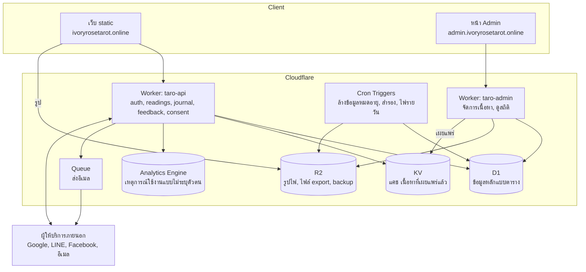
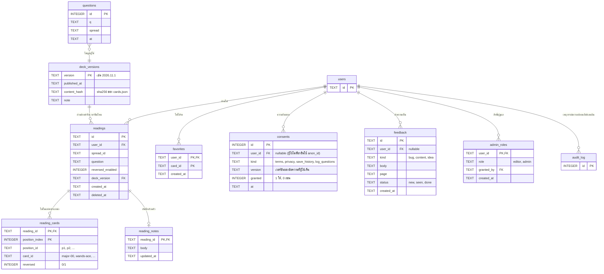

# แผน Backend ทั้งระบบ และการเก็บข้อมูลทุกประเภท

สถานะ: แผน ยังไม่มีโค้ด ไฟล์นี้คือภาพรวมทั้งหมด ส่วนระบบล็อกอินลงรายละเอียดไว้ใน `docs/07_AUTH_BACKEND_PLAN_TH.md` (ตาราง `users`, `identities`, `credentials`, `sessions`, `email_tokens`, `audit_log` อยู่ในไฟล์นั้น ไม่ซ้ำที่นี่)

## 1. ภาพรวม

ตอนนี้เว็บเป็น static ทั้งหมด (HTML + JSON + รูป) มี backend อย่างเดียวคือ Worker เก็บคำถาม แผนนี้เพิ่ม backend จริง แต่ยังอยู่บน Cloudflare เพื่อไม่ต้องดูแลเซิร์ฟเวอร์เอง



## 2. ข้อมูลทุกอย่างเก็บที่ไหน

| ข้อมูล | ที่เก็บ | เหตุผล | เก็บนานแค่ไหน |
|---|---|---|---|
| บัญชีผู้ใช้, วิธีล็อกอิน, session | D1 | ต้อง query และ join ต้องถูกต้องเสมอ | จนผู้ใช้ลบบัญชี, session หมดอายุ 30 วัน |
| รหัสผ่าน | D1 (เฉพาะ hash) | ไม่เก็บรหัสจริง | จนลบบัญชี |
| ประวัติการอ่านไพ่ | D1 | ผู้ใช้ดูย้อนหลัง ลบรายการได้ | จนผู้ใช้ลบ (opt-in เท่านั้น) |
| บันทึกส่วนตัว (journal) ต่อการอ่าน | D1 | เป็นข้อความของผู้ใช้ | จนผู้ใช้ลบ |
| ไพ่โปรด / ปักหมุด | D1 | ข้อมูลเล็กผูกกับผู้ใช้ | จนผู้ใช้ลบ |
| ความยินยอม (consent) | D1 | ต้องพิสูจน์ได้ว่าใครยินยอมอะไร เมื่อไหร่ | ตามกฎหมาย แม้บัญชีถูกลบให้เก็บแบบไม่ระบุตัวตน |
| คำถามแบบไม่ล็อกอิน (ตัวเก็บเดิม) | D1 ตาราง `questions` | มีอยู่แล้ว ไม่ผูกกับผู้ใช้ | 90 วัน แล้วลบอัตโนมัติ |
| Feedback / รายงานปัญหา | D1 | admin ต้องจัดการสถานะ | 1 ปี |
| เหตุการณ์ใช้งาน (เปิดหน้า, เลือก spread, อ่านจบ) | Analytics Engine | ปริมาณมาก ไม่ต้องผูกตัวตน ใช้ดูสถิติรวม | ตามที่บริการกำหนด ไม่ต้องจัดการเอง |
| เนื้อหาไพ่/spread/ความหมาย (ต้นฉบับ) | Git (`data/*.json`) | ตรวจทานได้ มีประวัติ เป็นแหล่งจริง | ถาวร |
| เนื้อหาที่เผยแพร่แล้ว (สำเนาให้เว็บอ่านเร็ว) | KV + JSON ใน static | อ่านบ่อย เขียนน้อย | แทนที่เมื่อเผยแพร่ใหม่ |
| รูปไพ่ PNG ต้นฉบับ + WebP | R2 (เว็บยังใช้ไฟล์ใน repo ได้ระหว่างเปลี่ยนผ่าน) | ไฟล์ใหญ่ ไม่ควรอยู่ใน D1 | ถาวร |
| ไฟล์ export ข้อมูลผู้ใช้ (PDPA) | R2 ชั่วคราว | ให้ดาวน์โหลดครั้งเดียว | 24 ชั่วโมง |
| Backup ฐานข้อมูล | R2 | กู้คืนเมื่อเสียหาย | 30 วันย้อนหลัง |
| Secret (client secret, คีย์ลงลายเซ็น) | Worker secrets | ห้ามอยู่ใน repo หรือ DB | หมุนคีย์ปีละครั้ง |

ข้อสำคัญ: ต้นฉบับเนื้อหาไพ่ **ยังเก็บใน Git** ไม่ย้ายเข้า DB ตอนนี้ เพราะผ่านการตรวจด้วยสคริปต์ (`scripts/validate_data.py`) และมีประวัติแก้ไข ย้ายไป DB เมื่อมีคนที่ไม่ใช่ dev ต้องแก้เนื้อหาบ่อย (ดูหัวข้อ 6)

## 3. ผังตารางข้อมูลทั้งหมด

ตารางส่วนล็อกอินเป็นสีเทา (รายละเอียดใน 07) ที่เหลือคือตารางใหม่



### SQL (ตารางใหม่)

```sql
CREATE TABLE deck_versions (
  version TEXT PRIMARY KEY,
  published_at TEXT NOT NULL,
  content_hash TEXT NOT NULL,
  note TEXT
);

CREATE TABLE readings (
  id TEXT PRIMARY KEY,
  user_id TEXT NOT NULL REFERENCES users(id) ON DELETE CASCADE,
  spread_id TEXT NOT NULL,
  question TEXT,
  reversed_enabled INTEGER NOT NULL DEFAULT 0,
  deck_version TEXT NOT NULL REFERENCES deck_versions(version),
  created_at TEXT NOT NULL,
  deleted_at TEXT
);
CREATE INDEX readings_user ON readings(user_id, created_at DESC);

CREATE TABLE reading_cards (
  reading_id TEXT NOT NULL REFERENCES readings(id) ON DELETE CASCADE,
  position_index INTEGER NOT NULL,
  position_id TEXT NOT NULL,
  card_id TEXT NOT NULL,
  reversed INTEGER NOT NULL DEFAULT 0,
  PRIMARY KEY (reading_id, position_index),
  UNIQUE (reading_id, card_id)            -- ไพ่ไม่ซ้ำในการอ่านเดียว
);
CREATE INDEX reading_cards_card ON reading_cards(card_id);   -- สถิติไพ่ที่ถูกเปิดบ่อย

CREATE TABLE reading_notes (
  reading_id TEXT PRIMARY KEY REFERENCES readings(id) ON DELETE CASCADE,
  body TEXT NOT NULL,
  updated_at TEXT NOT NULL
);

CREATE TABLE favorites (
  user_id TEXT NOT NULL REFERENCES users(id) ON DELETE CASCADE,
  card_id TEXT NOT NULL,
  created_at TEXT NOT NULL,
  PRIMARY KEY (user_id, card_id)
);

CREATE TABLE consents (
  id INTEGER PRIMARY KEY,
  user_id TEXT REFERENCES users(id) ON DELETE SET NULL,
  anon_id TEXT,                              -- สุ่มเก็บในเบราว์เซอร์ สำหรับคนไม่ล็อกอิน
  kind TEXT NOT NULL CHECK (kind IN ('terms','privacy','save_history','log_questions')),
  version TEXT NOT NULL,
  granted INTEGER NOT NULL,
  at TEXT NOT NULL
);
CREATE INDEX consents_user ON consents(user_id, kind, at DESC);

CREATE TABLE feedback (
  id TEXT PRIMARY KEY,
  user_id TEXT REFERENCES users(id) ON DELETE SET NULL,
  kind TEXT NOT NULL CHECK (kind IN ('bug','content','idea')),
  body TEXT NOT NULL,
  page TEXT,
  status TEXT NOT NULL DEFAULT 'new' CHECK (status IN ('new','seen','done')),
  created_at TEXT NOT NULL
);

CREATE TABLE admin_roles (
  user_id TEXT PRIMARY KEY REFERENCES users(id) ON DELETE CASCADE,
  role TEXT NOT NULL CHECK (role IN ('editor','admin')),
  granted_by TEXT REFERENCES users(id),
  created_at TEXT NOT NULL
);
```

ทำไมแยก `reading_cards` ออกจาก `readings` แทนการเก็บ JSON ก้อนเดียว: query สถิติได้ (ไพ่ไหนถูกเปิดบ่อย, ตำแหน่งไหนมักได้ไพ่ลักษณะไหน) บังคับ "ไม่ซ้ำ" ที่ฐานข้อมูลได้ และไม่ต้องแก้ JSON ทุกครั้งที่เปลี่ยนโครง

ทำไมมี `deck_versions`: ถ้าวันหน้าแก้ความหมายไพ่หรือเปลี่ยนชื่อ ประวัติเก่าต้องแสดงตามเวอร์ชันที่ผู้ใช้เห็นตอนนั้นได้ และ `card_id` ต้องไม่เปลี่ยนความหมายย้อนหลัง

## 4. API ภาพรวม (นอกเหนือจาก auth ใน 07)

| Method | Path | หน้าที่ | ล็อกอิน |
|---|---|---|---|
| GET | `/content/deck` | เนื้อหาไพ่ที่เผยแพร่ล่าสุด + `deck_version` (แคชที่ KV) | ไม่ |
| POST | `/log/question` | ตัวเก็บคำถามเดิม (ย้ายมารวมได้ภายหลัง) | ไม่ |
| POST | `/events` | ส่งเหตุการณ์ใช้งานแบบไม่ระบุตัวตน | ไม่ |
| POST | `/feedback` | ส่งความเห็น/แจ้งปัญหา | ไม่ (ล็อกอินแล้วผูกให้) |
| POST | `/consents` | บันทึกการให้/ถอนความยินยอม | ไม่ (ใช้ `anon_id`) |
| GET | `/me/readings?cursor=` | รายการประวัติ (แบ่งหน้า) | ใช่ |
| POST | `/me/readings` | บันทึกการอ่านหนึ่งครั้ง | ใช่ + ต้องมี consent `save_history` |
| GET | `/me/readings/:id` | ดูรายละเอียดหนึ่งรายการ | ใช่ (เจ้าของเท่านั้น) |
| PUT | `/me/readings/:id/note` | เขียน/แก้บันทึก | ใช่ |
| DELETE | `/me/readings/:id` | ลบรายการ | ใช่ |
| GET/PUT/DELETE | `/me/favorites/:card_id` | ไพ่โปรด | ใช่ |
| POST | `/me/export` | ขอไฟล์ข้อมูลทั้งหมดของตัวเอง (JSON ใน R2 ลิงก์ 24 ชม.) | ใช่ |
| DELETE | `/me` | ลบบัญชี + ข้อมูลทั้งหมด (ดู 07) | ใช่ |

กฎตรวจที่ฝั่งเซิร์ฟเวอร์ตอน `POST /me/readings`: `spread_id` ต้องมีใน spreads, จำนวนไพ่ตรงกับ spread, `card_id` ทุกใบมีใน deck_version ที่ส่งมา, ไม่ซ้ำ, `question` ไม่เกิน 300 ตัวอักษร, `note` ไม่เกิน 2,000 ตัวอักษร, ผู้ใช้หนึ่งคนบันทึกได้ไม่เกินจำนวนที่กำหนดต่อวัน

**ข้อตัดสินใจเรื่องการสุ่มไพ่:** ตอนนี้สุ่มที่เบราว์เซอร์ (rejection sampling ใน `scripts/reading-core.mjs` มีเทสต์แล้ว) ผู้ใช้เลือกไพ่เองทีละใบ จึงไม่มีเหตุให้ย้ายไปสุ่มที่เซิร์ฟเวอร์ เซิร์ฟเวอร์รับเฉพาะ "ผลที่ผู้ใช้เลือก" ไปเก็บ และตรวจความถูกต้องของโครงสร้างเท่านั้น ไม่ยืนยันว่าสุ่มจริง (ไม่จำเป็น เพราะไม่มีรางวัลหรือผลทางการเงิน)

## 5. งานเบื้องหลัง (Cron / Queue)

| งาน | ความถี่ | ทำอะไร |
|---|---|---|
| ล้าง session หมดอายุ + email token หมดอายุ | ทุกวัน | `DELETE ... WHERE expires_at < now` |
| ล้างคำถามแบบไม่ล็อกอินเกิน 90 วัน | ทุกวัน | ตามตาราง retention |
| ลบถาวรบัญชีที่ `deleted_at` เกิน 30 วัน | ทุกวัน | ให้เวลาเปลี่ยนใจ แล้วลบข้อมูลจริง |
| Backup D1 ไป R2 | ทุกวัน | export เป็นไฟล์ เก็บ 30 วัน (ใช้คู่กับ Time Travel ของ D1) |
| ลบไฟล์ export หมดอายุใน R2 | ทุกชั่วโมง | ไฟล์เกิน 24 ชม. |
| ส่งอีเมล | ผ่าน Queue | ลองซ้ำเมื่อล้มเหลว ไม่ให้ request ของผู้ใช้ค้างรอ |
| ไพ่รายวัน (ถ้าทำฟีเจอร์นี้) | ทุกวัน | สุ่มไพ่หนึ่งใบแบบกำหนดจากวันที่ เก็บใน KV ให้ทุกคนเห็นใบเดียวกัน |

## 6. หลังบ้านสำหรับผู้ดูแล (Admin)

เฟสแรกไม่ต้องทำหน้าเว็บ admin เต็มรูปแบบ ทำเป็นขั้นตอน:

1. **เริ่ม:** จัดการเนื้อหาผ่าน Git + สคริปต์ (วิธีที่ทำอยู่) เพิ่มสคริปต์ `publish_deck` ที่คำนวณ `content_hash`, ใส่แถวใน `deck_versions`, อัปโหลด JSON ที่เผยแพร่ไป KV
2. **ต่อมา:** เมื่อมีคนที่ไม่ใช่ dev ต้องแก้ข้อความ ค่อยทำ `taro-admin` + หน้า admin:
   - ล็อกอินด้วยบัญชีเดียวกับผู้ใช้ แต่ต้องมีแถวใน `admin_roles` และเปิด 2FA
   - `editor` แก้ข้อความไพ่เป็นฉบับร่าง `admin` กดเผยแพร่ (สร้าง `deck_versions` ใหม่)
   - ดูและจัดการ feedback เปลี่ยนสถานะ
   - ดูสถิติรวม (ไพ่ที่ถูกเลือกบ่อย, spread ยอดนิยม, ผู้ใช้ใหม่รายวัน) จาก Analytics Engine และ `reading_cards`
   - ทุกการกระทำของ admin เขียนลง `audit_log`
3. **เนื้อหาในแอดมิน:** ถ้าจะย้ายข้อความไพ่เข้า DB ต้องเพิ่มตาราง `card_texts(card_id, deck_version, field, body)` และรักษาให้ `scripts/validate_data.py` ตรวจฉบับที่ export กลับออกมาเป็น JSON ได้เหมือนเดิม

## 7. ความเป็นส่วนตัวและวงจรชีวิตข้อมูล

- **ลบบัญชี:** `deleted_at` ทันทีและตัด session ทั้งหมด หลัง 30 วันลบจริงทุกตารางที่ผูก `user_id` (ใช้ `ON DELETE CASCADE`) ส่วน `consents` และ `audit_log` เปลี่ยน `user_id` เป็น NULL เพื่อเก็บหลักฐานแบบไม่ระบุตัวตน
- **ส่งออกข้อมูล:** `POST /me/export` สร้าง JSON ของ users, identities (ไม่รวม token), readings, notes, favorites, consents ลง R2
- **Backup มีข้อมูลผู้ใช้:** ลบบัญชีแล้วข้อมูลยังอยู่ใน backup ได้ถึง 30 วัน ต้องบอกในนโยบายความเป็นส่วนตัว
- **คำถามและบันทึกเป็นข้อความอิสระ** อาจมีข้อมูลอ่อนไหว: ไม่ส่งเข้า Analytics, ไม่ใส่ใน log, จำกัดผู้เข้าถึงเฉพาะ `admin`, และถ้าจะเข้ารหัสในระดับแอป (เก็บ ciphertext ใน D1) ให้ตัดสินใจตั้งแต่ต้น เพราะเพิ่มทีหลังต้อง migrate ข้อมูลเก่า
- **เด็ก:** ถ้ากลุ่มเป้าหมายรวมผู้ใช้ต่ำกว่า 18 ปี ต้องปรึกษานโยบายเรื่องความยินยอมผู้ปกครอง

## 8. การจัดการ schema และสภาพแวดล้อม

- ใช้ `wrangler d1 migrations` ไฟล์ SQL ลำดับเลข (`0001_auth.sql`, `0002_readings.sql`, ...) ห้ามแก้ไฟล์ที่ deploy แล้ว ให้เพิ่มไฟล์ใหม่เสมอ
- แยก 2 สภาพแวดล้อม: `staging` (D1 และ secret ชุดทดสอบ) กับ `production` ใน `wrangler.toml` ทดสอบ migration บน staging ก่อนเสมอ
- เทสต์: ใช้ SQLite ในเครื่อง (`wrangler dev --local` หรือ miniflare) รัน migration ทั้งหมดแล้วทดสอบ API ทุก endpoint รวมกรณี "ผู้ใช้ A เข้าถึงข้อมูลผู้ใช้ B ต้องถูกปฏิเสธ" ทุก endpoint ที่มี `:id`
- โค้ดแยกโฟลเดอร์: `api/` (auth, readings, ...), `admin/`, `migrations/`, `shared/` (hash, session, validate) ย้าย `worker/` เดิมเข้ามาเป็นส่วนหนึ่งเมื่อพร้อม

## 9. ข้อจำกัดที่ควรรู้

- D1 เป็น SQLite มีเพดานขนาดต่อฐานข้อมูลและจำนวน query ต่อ request (ตรวจตัวเลขล่าสุดในเอกสาร Cloudflare ก่อนออกแบบเรื่อง scale) ข้อมูลระดับหลักแสนผู้ใช้ยังพอ ถ้าโตกว่านั้นต้องแยกฐานข้อมูล เช่น แยก `readings` ออกเป็นฐานของตัวเอง
- Worker มีเพดาน CPU ต่อ request การแฮชรหัสผ่านกินเวลาจึงต้องตั้งจำนวนรอบให้พอดี และทดสอบบน production-like
- KV เป็น eventually consistent เหมาะกับเนื้อหาที่เผยแพร่ ไม่เหมาะกับข้อมูลที่ต้องถูกต้องทันที (เช่น session) ซึ่งอยู่ใน D1

## 10. แผนทำเป็นเฟส (รวมกับ 07)

| เฟส | งาน |
|---|---|
| 0 | ตอบคำถามหัวข้อ 11 และใน 07 จด `api.` / `admin.` ลงทะเบียน provider |
| 1 | โครง `taro-api`, migrations, helper, ย้าย `taro-log` เข้ามา, staging |
| 2 | ล็อกอินอีเมล + social (ตาม 07) |
| 3 | `consents`, `readings` + `reading_cards`, favorites, notes พร้อมเทสต์สิทธิ์ข้ามผู้ใช้ |
| 4 | Cron ล้างข้อมูล, backup, export/ลบบัญชี |
| 5 | `deck_versions` + สคริปต์ publish + KV |
| 6 | feedback + events + สถิติ |
| 7 | UI เว็บ: ปุ่มล็อกอิน, ประวัติ, บันทึก, หน้านโยบาย |
| 8 | (ถ้าต้องการ) Admin UI + ย้ายเนื้อหาเข้า DB |

## 11. คำถามที่ต้องตอบเพิ่มจาก 07

1. ฟีเจอร์ไหนที่ต้องการจริงในรอบแรก: ประวัติ, บันทึกส่วนตัว, ไพ่โปรด, ไพ่รายวัน (ตัดตารางและ endpoint ของอันที่ไม่เอาได้เลย)
2. ใครแก้เนื้อหาไพ่ ถ้ามีแต่ dev ใช้ Git ต่อไปได้ ไม่ต้องทำ admin UI
3. ต้องการเข้ารหัสคำถาม/บันทึกในระดับแอปหรือไม่ (ผู้ใช้อ่านได้คนเดียว แลกกับ admin ดูสถิติจากข้อความไม่ได้ และกู้ข้อมูลถ้าผู้ใช้ทำคีย์หายไม่ได้)
4. ผู้ใช้เป้าหมายอยู่ที่ไหน (ไทยอย่างเดียว หรือมียุโรป เพราะกำหนดว่าต้องทำ GDPR ด้วยหรือไม่)
5. ต้องการแจ้งเตือน (อีเมลไพ่รายวัน, LINE Official Account) หรือไม่ ถ้าใช่ต้องเพิ่มตารางการสมัครรับและกฎความยินยอมแยก
